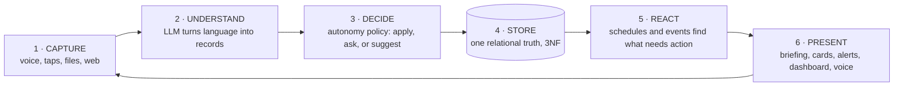

# Merc from first principles

> Why each part of the design exists, derived from basic facts instead of from the spec's feature list.
> Read this before [`01-architecture.md`](01-architecture.md), [`02-data-model.md`](02-data-model.md) and [`03-progress.md`](03-progress.md).

---

## 1. The basic facts (things we take as true)

| # | Fact | Why it's true |
|---|---|---|
| F1 | A rep's scarce resource is **attention**, not software features | They drive, carry samples, talk to owners. Hands and eyes are busy. |
| F2 | A CRM is only worth the **completeness × freshness** of its data | Incomplete and out-of-date data gives wrong decisions, so nobody trusts it, so nobody fills it. |
| F3 | Data entry cost is **why** CRMs are incomplete and out of date | Typing after every visit costs minutes per visit. People skip costs that don't pay them back directly. |
| F4 | Speaking costs ~0 extra attention; typing doesn't | A rep already talks all day, including in the car. |
| F5 | LLMs can turn free speech into structured records, but are **probabilistic** | They will sometimes be wrong: wrong customer, wrong number, invented detail. |
| F6 | The cost of an AI mistake depends on **who sees it and whether it can be undone** | A wrong internal note is cheap to fix. A wrong email to a customer can't be unsent. |
| F7 | Knowledge **decays** unless something acts on it at the right time | A promise or a quiet customer only matters if someone is reminded before it's too late. |
| F8 | New revenue comes from **outside** the current data | Shops that aren't customers yet aren't in the CRM. Someone has to find them. |
| F9 | The **company** pays and outlives any rep | Relationships must survive turnover. |
| F10 | Management value = **aggregation** of many reps' signals | One rep's note is an anecdote. 200 reps' structured notes are market truth. |
| F11 | The field has **no guaranteed signal** | Basements, rural roads. |

### Evidence for F2 and F3
Only sources checked at the original page are listed. They are vendor and analyst surveys, mostly of office and inside sales, and none covers Greece. Treat them as directional until we have interviews with Greek field-sales teams.

| Supports | Finding | Source |
|---|---|---|
| F3 | The average seller spends 40% of their time selling. Gen Z reps lose about two hours a week to manual data entry. | Salesforce, *State of Sales, 7th edition*: survey of 4,050 sales professionals in 22 countries, Aug to Sep 2025. [Announcement](https://www.salesforce.com/news/stories/state-of-sales-report-announcement-2026/) |
| F2 | 24% of CRM admins say less than half of their CRM data is accurate and complete. | Validity, *The State of CRM Data Management in 2024*. [Report page](https://www.validity.com/resource-center/the-state-of-crm-data-management-in-2024/) |
| F2 | CRM is widely adopted, but satisfaction with current CRM solutions is low overall and initiatives fail to deliver on expectations. | Forrester, *Customer Relationship Management Market Insights, 2023*. [Blog summary](https://www.forrester.com/blogs/forrester-data-shows-high-crm-adoption-but-low-satisfaction/) |

**Not yet evidenced:** that data entry cost is the main *cause* of incomplete CRMs, and that the pattern holds for Greek field reps. Both need customer interviews or a real CRM export.

---

## 2. What each fact forces

| Fact(s) | Consequence | Becomes in the design |
|---|---|---|
| F1, F4 | Input must be **voice**, output must be **short** | Voice buddy; ≤ 90 s briefing; one-hand screens |
| F2, F3, F4 | Entry cost must drop to ~0: **speech → structured data automatically** | Debrief (the headline feature) |
| F5 | Machine output needs **guards** | Never invent numbers; ask when unsure; confirm the customer |
| F5, F6 | **Autonomy must depend on the mistake's cost**, not be one global switch | Autonomy engine: internal = auto + undo, external = approval, destructive = never |
| F5, F6 | Every AI write must be **visible and reversible** | `ai_action` log with before/after snapshot; result card with undo |
| F7 | The system must **act on time**, not only answer questions | Scheduled jobs: alerts hourly, briefing every morning, approval expiry |
| F8 | A pipeline that **brings the outside in** | Prospecting: find → dedupe → research → score → route |
| F9 | Memory and history belong to the **account**, not the rep | Customer memory keyed by `account.id`; bulk transfer keeps history |
| F10 | Data must be **structured and consistent** so it can be summed correctly | Relational tables in 3NF (one fact, one place) |
| F11 | Capture must work **offline**, processing can wait | Local recording queue with automatic sync |
| F1 + F10 | Two audiences, two interfaces, **one truth** | Rep app + voice and management desktop, all reading the same tables through the same functions |

---

## 3. Two rules that decide every implementation choice

### Rule A: use the LLM only where the input or the output is human language
| Job | Input/output is language? | So we use |
|---|---|---|
| Understand the debrief | Yes (speech in) | LLM, structured output |
| Write the email draft / briefing script / pitch | Yes (text out) | LLM |
| Score a shop against the ICP | Partly (reasons are text) | LLM decision with fixed weights |
| "Customer going quiet" | No (date arithmetic) | Plain code |
| What goes in the briefing, in what order | No (ranking rules) | Plain code, then LLM only words it |
| Permissions, visibility, undo | No | Plain code |

This is the cheapest way to get "numbers are never made up": **numbers never pass through the LLM as something it decides.** It is also faster, cheaper and testable.

### Rule B: one business layer, many front doors
The rep can tap or talk, the manager can click, a schedule can fire. If each path had its own logic, they would drift apart and give different results. So **all logic lives in one set of functions**, and the app, the voice buddy and the scheduled jobs are thin callers.

---

## 4. The minimum system: six primitives

Everything in Merc is a combination of six things:

| Primitive | Question it answers | Wonderful piece |
|---|---|---|
| 1 Capture | How does information get in? | Browser voice + `merc-buddy`, App, Integration Hub (Firecrawl, directories), file upload |
| 2 Understand | What did that mean? | Functions calling Model Profiles (structured output) |
| 3 Decide | Am I allowed to act on it? | Autonomy engine (shared lib) + `ai_permission` table + Governance as a second lock |
| 4 Store | What is true right now? | Wonderful Tables, schema `merc` |
| 5 React | What needs attention, and when? | Cron functions, Procedures, Backoffice agents |
| 6 Present | What should this person see or hear now? | Wonderful App (rep + management), buddy voice, WebSocket push |

Every spec feature maps onto this loop:

| Feature | Capture | Understand | Decide | Store | React | Present |
|---|---|---|---|---|---|---|
| Voice logging | voice | extract | per action | ✓ | — | result card |
| Briefing | calendar | — | — | ✓ | 07:45 job | voice + screen |
| Alerts | — | — | — | ✓ | hourly job | feed |
| Approvals | "yes, send it" | — | human | ✓ | expiry job | inbox |
| Prospecting | directory + web | dossier, score | add to route | ✓ | pipeline | new shops |
| Campaigns | manager input | pitched? (from debrief) | — | ✓ | — | briefing + cards |
| Import | file | column mapping | human confirm | ✓ | — | report |
| Dashboard | — | — | — | ✓ | daily rollup | charts |

---

## 5. Why 3NF here specifically

F10 says the value is in **adding up** many reps' signals. Aggregates are only correct if each fact is stored once:

- If a customer's city were on both the account and its orders, a fix to one copy leaves the other wrong, and "sales by city" is wrong.
- If an order's total were stored next to its lines, an edited line makes the total lie.
- If permissions copied an action's "class", changing the class would leave old rows inconsistent.

3NF removes those contradictions by design. The few exceptions (rollup tables for dashboards, an activity timestamp cache on deals) are **derived, rebuilt by jobs, and never edited by hand**, so they can't drift from the truth.

---

## 6. What this says about the order of work

The product's core claim is one loop: **the rep talks → the CRM is right → they trust it.** Everything else amplifies that loop. So the order follows from that:

| Order | Build | Because |
|---|---|---|
| 1 | Data core + autonomy engine + debrief | It is the claim. Without it nothing else has data. |
| 2 | Visit card + briefing + alerts | They **spend** the data the debrief created, which is what makes reps keep talking. |
| 3 | Approvals + real email | The trust moment: the AI asks before the customer sees anything. |
| 4 | Prospecting | New revenue, but it depends on 1–3 to land the new customer. |
| 5 | Management dashboard | Pure aggregation of 1–4; worthless without data. |

### First-principles cut for the hackathon
The loop needs about **15 of the ~50 tables**: `organization, app_user, role, account, contact, deal, deal_stage, product, sales_order, order_line, visit, activity, task, problem, competitor_signal, voice_log, ai_action, action_type, ai_permission, approval, alert`. The full schema in `02-data-model.md` is the target for scale. Build those first, add the rest only when a feature needs them.

---

## 7. Test of the design

Each component should be traceable back to a fact. If a component can't be, cut it.

| Component | Traces to |
|---|---|
| Voice buddy | F1, F4 |
| Debrief | F2, F3 |
| "Never invent" guards | F5 |
| Autonomy engine + undo | F5, F6 |
| Alerts / briefing jobs | F7 |
| Prospecting pipeline | F8 |
| Account-keyed memory, bulk transfer | F9 |
| 3NF tables, dashboard | F10 |
| Offline queue | F11 |
| One function layer | Rule B |
| LLM-only-for-language split | Rule A |
