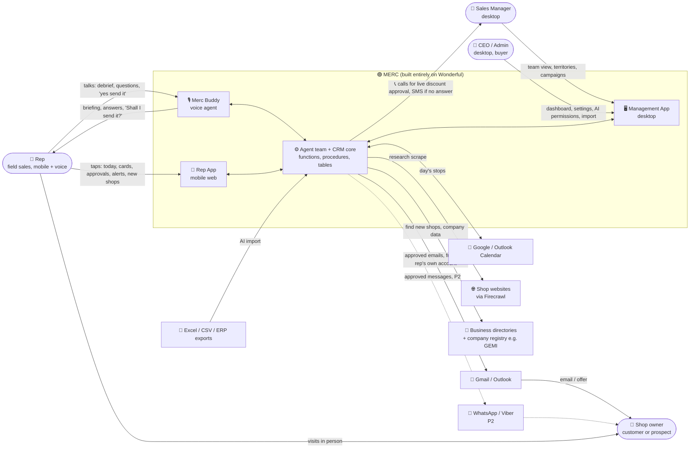
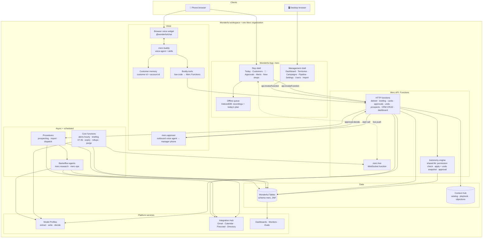
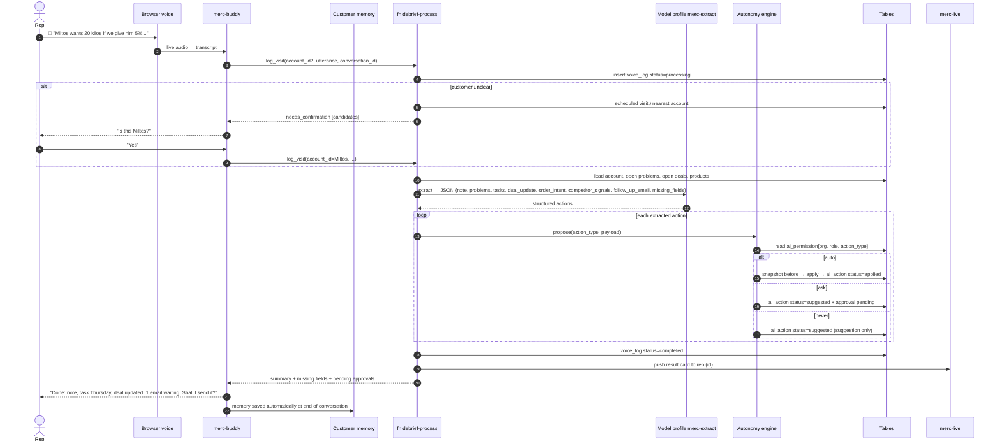
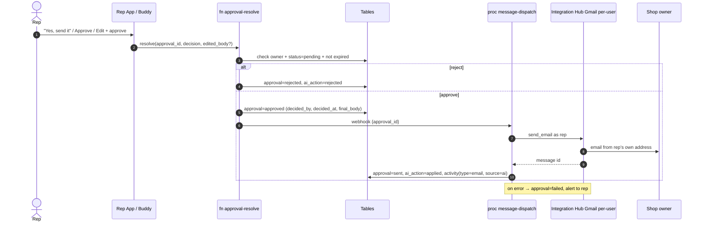
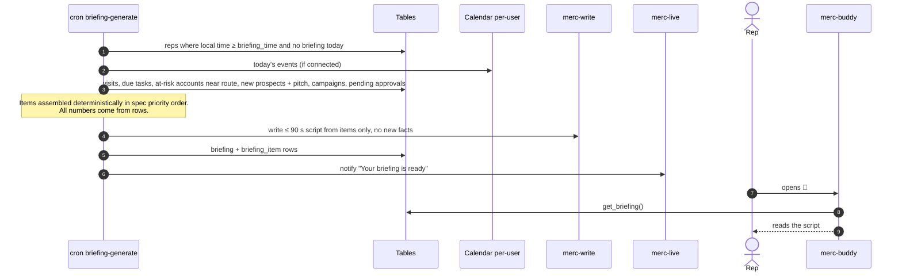
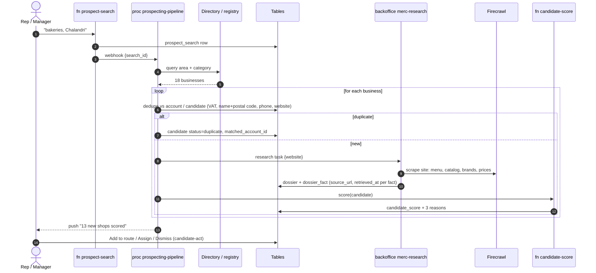
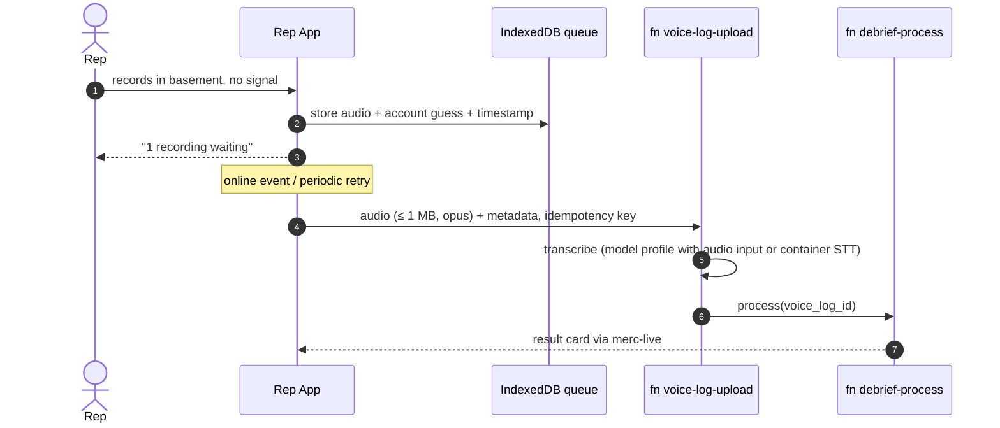
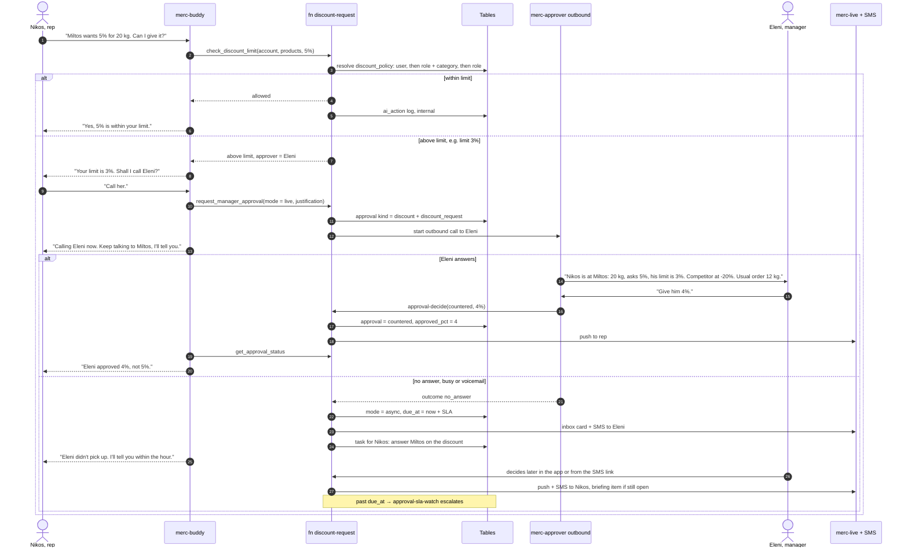
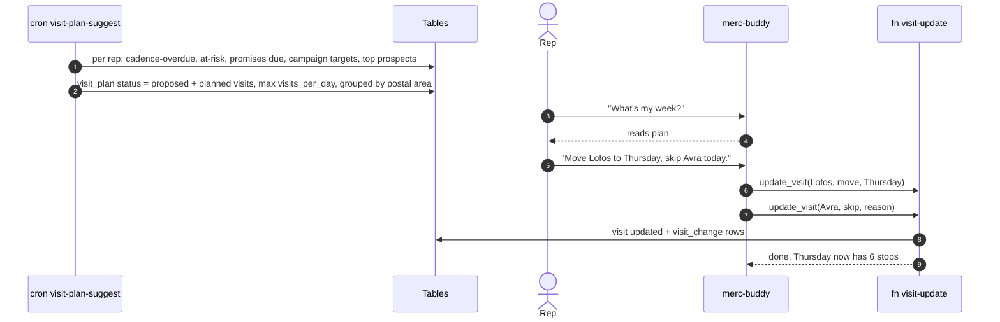

# Merc on Wonderful: Architecture

> Source spec: `../merc-business-spec/merc-business-en/` (00–08).
> Scope: the **whole product** on the Wonderful platform, including the voice buddy. Everything is built by builder agents from `../spec/SPEC.md` and `../spec/contracts/`.
> Data model lives in [`02-data-model.md`](02-data-model.md). Progress lives in [`03-progress.md`](03-progress.md).

---

## 1. High level: stakeholders, systems, how they talk

### The four information flows (spec 07)
| Flow | Path |
|---|---|
| **Signals go up** | Rep voice → Buddy → Debrief → tables → alerts + management dashboard |
| **Instructions come down** | Manager campaign/territory → tables → rep briefing + visit cards |
| **Outside world comes in** | Directories/registry → candidates → Firecrawl research → score → rep's route |
| **Messages go out** | Agent draft → approval (rep) → Gmail/Outlook from the rep's account → shop |

---

## 2. Wonderful component inventory

Every box in the diagrams below maps to a concrete Wonderful resource.

| # | Wonderful resource | Merc component(s) | Why this resource |
|---|---|---|---|
| 1 | **Conversational agent (voice), Agents V2** | `merc-buddy` | Live two-way voice, Greek/English, tools, customer memory. Built by builder agents (REQ-BUD-*). |
| 2 | **Browser voice / Chat SDK** (`@wonderful/chat`, `modalities: ["voice"]`) | Buddy embedded in the Rep App (🎤 button) | Rep talks to the buddy from the phone browser, no phone call needed. |
| 3 | **Customer memory** | Per-shop memory ("how to talk to them") | Memories belong to the **workspace**, not the rep → satisfies "knowledge stays with the company". Customer ID = `account.id`. |
| 4 | **Wonderful App** (React bundle) | `merc` app with two shells: **Rep** (mobile) and **Management** (desktop) | One bundle, role-based routing. Calls only Functions (`api.invokeFunction`). |
| 5 | **App roles & permissions** | Roles `rep`, `manager`, `admin`; function gates; resource scoping by relation (`owner`, `territory_member`, `team_manager`) | Enforces the visibility matrix (spec 02) server-side. |
| 6 | **Functions (HTTP)** | The Merc API: ~30 endpoints (catalog §5) | Single business-logic layer, shared by App and Buddy tools ("same logic everywhere"). |
| 7 | **WebSocket function** | `merc-live` push channel | Live result card after debrief, "3 recordings waiting", new approval badge. |
| 8 | **Cron functions** | Alerts engine, briefing generator, approval expiry, KPI rollups, retention purge, weekly summary trigger | Scheduled agents from spec 06. |
| 9 | **Procedures** (beta) | Prospecting pipeline, AI import pipeline, approved-message dispatch | Durable multi-step flows with For-each, waits, retries; long work beyond a 30–60 s function timeout. |
| 10 | **Backoffice agent(s)** | `merc-research` (dossier building in a sandbox), `merc-ops` (weekly summary, import mapping review) | Long, reviewable, tool-heavy work with `action_required` human review. |
| 11 | **Wonderful Tables** (schema `merc`) | CRM core, ~45 tables, 3NF, foreign keys + indexes | Real Postgres, FKs inside one schema. See data model. |
| 12 | **Model Profiles / Model Registry** | `merc-extract` (structured output), `merc-write` (drafts, briefing script), `merc-decide` (Decision model for scoring/classification) | Model choice and fallbacks without code changes. |
| 13 | **Context Hub** | Product catalog sheets, sales playbook, objection library, ICP description | RAG grounding for visit cards, pitches, rehearsal. |
| 14 | **Integration Hub** | Gmail/Outlook (**per-user**), Calendar (**per-user**), Firecrawl (custom MCP or secret + fetch), directory/registry API (service account), WhatsApp (P2) | Governed external actions, per-user identity = "sent from the rep's own account". |
| 15 | **Governance policies** | "External send requires approval" safety net on Gmail/WhatsApp actions | Second lock behind our own approval engine. |
| 16 | **Secrets / Global variables** | Firecrawl key, directory API key, feature flags | No keys in code. |
| 17 | **Dashboards** (custom table data sources) | CEO/manager KPI views (optional, the App has its own) | Fast win for J3 demo. |
| 18 | **Monitors + Alerts** | Ops health: debrief latency > 20 s, function error rate, failed voice logs | Non-functional requirement tracking. |
| 19 | **Evals** | Buddy scenarios + Debrief golden set (Greek/English/mixed, noise, unknown customer) | Spec 06 "Quality" section. |
| 20 | **Workspace** | One workspace = one customer organization | Platform-level data isolation (spec 02 rule). Deploy per customer via Terraform / plugin packaging. |
| 21 | **Outbound voice agent + Campaigns (outbound dialing)** | `merc-approver`: calls the manager for a live discount decision | The platform dials, retries and reports the outcome (answered / no answer / busy / voicemail), which drives the async fallback |
| 22 | **SMS** (`context.telephony.sendSms`) | Notify manager and rep about async approvals and decisions | Works from functions and cron, no live call needed |
| 23 | **Text chat agent** (Chat SDK, in the Management app) | `merc-insights` (P2 stretch): "why did the North drop?" | Read-only tools over rollups; numbers only from queries |

---

## 3. Container view (inside Wonderful)

---

## 4. Agents → Wonderful mapping (spec 06)

| Spec agent | Implemented as | Trigger | Reads | Writes |
|---|---|---|---|---|
| **Buddy (coordinator)** | `merc-buddy` voice agent | Rep opens 🎤 | Memory, tools → Functions | Via Functions only |
| **Debrief** | Function `debrief-process` + `merc-extract` profile | Buddy tool `log_visit`, or offline upload | voice_log, account, open problems/deals, products, **active campaigns for the account** | activity, task, problem, deal, sales_order (draft), competitor_signal, **contact**, **campaign_exposure (pitched)**, visit (done), ai_action, approval |
| **Briefing** | Cron `briefing-generate` (every 15 min, fires per rep at org's `briefing_time` in org timezone) + Function `briefing-get` on demand | Schedule / request | visits, tasks, alerts, campaigns, candidates near route, approvals | briefing, briefing_item |
| **Visit card** | Function `visit-card-get` (+ Context Hub) | Rep opens card / buddy asks | account, history, account_metrics, products, campaigns, dossier | campaign_exposure (shown) |
| **Research** | Backoffice agent `merc-research` (Firecrawl via Integration Hub) | Prospecting procedure step | candidate website, registry data | dossier, dossier_fact |
| **Scoring** | Function `candidate-score` with `merc-decide` | Procedure step after dossier | dossier, icp_* tables | candidate_score, candidate_score_reason |
| **Alerts** | Cron `alerts-engine` hourly | Schedule | orders, account_metrics, deals, tasks, competitor_signal, alert_rule | alert (dedupe by `dedupe_key`) |
| **Email/messages** | Function `draft-message` with `merc-write` | Debrief, alert one-tap, command | intent, account, contact, rep style samples | ai_action + approval |
| **Import** | Procedure `import-pipeline` + `merc-ops` for mapping review | Upload | file | data_import, import_column_mapping, import_row_issue, target tables |
| **Weekly summary** | Cron → `merc-ops` backoffice task | Monday 07:00 | kpi_daily, deals, alerts | email to manager/CEO (internal, auto) |
| **Pitch rehearsal** (P1) | Skill on `merc-buddy` | Rep asks "play the owner" | visit card (prospect) | activity (rehearsal note) |
| **Discount approver** (new) | Function `discount-check` / `discount-request` + outbound voice agent `merc-approver` | Rep asks for a discount above their limit | discount_policy, account history, deal, competitor signals | approval (kind discount), discount_request, manager_call |
| **Visit planner** (new) | Cron `visit-plan-suggest` + Function `visit-update` | Sunday evening, and any "move / skip / add" request | account cadence, account_metrics, tasks, campaigns, candidates, capacity | visit_plan, visit, visit_change |
| **CRM Q&A** (new) | Function `ask-crm` with `merc-decide` | Rep asks a free question | Fixed, safe query templates only | nothing (read-only) |
| **Account lifecycle** (new) | Cron `account-lifecycle` | Daily | account_metrics, orders | account_type → lost (ai_action, internal, undo) |
| **Monthly ROI report** (new) | Cron `monthly-report` → `merc-ops` | 1st of month | kpi_daily, baseline period | email to CEO |

### Buddy tool contract (normative version: `spec/contracts/tools/merc-buddy/`)
| Tool | Function called | Notes |
|---|---|---|
| `get_briefing()` | `GET briefing-get` | Returns `script` (≤ 90 s) + structured items |
| `get_visit_card(account_ref)` | `GET visit-card-get` | Accepts name/fuzzy ref → resolves or asks |
| `resolve_account(hint, lat?, lng?)` | `GET account-resolve` | "Nearest or scheduled" rule; returns candidates if ambiguous |
| `log_visit(account_id?, utterance, conversation_id)` | `POST debrief-process` | Raw rep words verbatim, never paraphrased |
| `list_approvals()` | `GET approvals-list` | |
| `resolve_approval(id, decision, edited_body?)` | `POST approval-resolve` | "Yes, send it" path |
| `undo_action(id)` | `POST ai-action-undo` | |
| `list_alerts()` / `act_on_alert(id, action)` | `GET alerts-list` / `POST alert-act` | |
| `find_shops(area, category)` | `POST prospect-search` | Starts the procedure, returns search id |
| `end_of_day()` (P1) | `GET eod-summary` | |
| `check_discount_limit(account_id, products[], discount_pct)` | `GET discount-check` | Resolves the rep's limit from `discount_policy`; within limit → allowed and logged |
| `request_manager_approval(account_id, deal_id?, products[], discount_pct, justification, mode)` | `POST discount-request` | `mode = live` starts the call to the manager; `async` goes straight to the inbox |
| `get_approval_status(approval_id)` | `GET approval-status` | The buddy checks while the rep waits ("Eleni is on the phone…") |
| `update_visit(visit_id or account_ref, action, date?, reason?)` | `POST visit-update` | move / skip / add / reorder, by voice |
| `get_week_plan()` / `accept_week_plan(edits?)` | `GET visit-plan-get` / `POST visit-plan-accept` | |
| `ask_crm(question, account_id?)` | `GET ask-crm` | Picks one safe query template + params; answers only from rows |
| `product_lookup(query)` | `GET product-lookup` | Name/SKU → price, category, active campaigns. Stock = "unknown" until ERP |
| `create_task(title, due, account_id?)` | `POST task-create` | Internal, auto + undo |
| `my_performance(period)` | `GET my-performance` | Target progress, visits, revenue |
| `add_candidate(name, location_hint)` | `POST candidate-add` | "New bakery on Ermou street" → goes through dedupe/research/score |
| `escalate_to_manager(account_id, reason)` | `POST escalate` | Task + alert for the manager |

Every tool call passes `rep_wonderful_user_id`; the Function maps it to `app_user` and applies the same role/visibility checks as the App.

---

## 5. Function catalog (Merc API)

Gate = app permission required (enforced by platform before the function runs). Scope = resource check inside the function.

| Slug | Method | Caller | Gate | Purpose |
|---|---|---|---|---|
| `me` | GET | App | — | Current app_user, role, territories, settings |
| `today-get` | GET | App | `plan.read` | Today's visits in order + map points |
| `briefing-get` | GET | App, Buddy | `plan.read` | Today's briefing (generate if missing) |
| `visit-card-get` | GET | App, Buddy | `accounts.read` (scope) | Customer or prospect card |
| `account-resolve` | GET | Buddy | `accounts.read` | Fuzzy name/location → account |
| `accounts-list` / `account-get` / `account-upsert` | GET/GET/POST | App | `accounts.*` (scope) | CRM CRUD |
| `contacts-*`, `deals-*`, `orders-*`, `tasks-*`, `problems-*` | CRUD | App | per entity | CRM CRUD |
| `voice-log-upload` | POST | App (offline sync) | `voicelog.create` | Audio (≤ 1 MB) or text → voice_log, then process |
| `debrief-process` | POST | Buddy, internal | `voicelog.create` | Extract → autonomy engine → result card (timeout 60 s, target < 20 s) |
| `debrief-result-get` | GET | App | `voicelog.read` (owner) | Result card with undo per line |
| `ai-action-undo` | POST | App, Buddy | `aiaction.undo` (owner) | Restore `before_snapshot` exactly |
| `approvals-list` | GET | App, Buddy | `approvals.read` (owner) | Pending "Shall I send it?" cards |
| `approval-resolve` | POST | App, Buddy | `approvals.decide` (owner) | Approve / edit+approve / reject → dispatch |
| `alerts-list` / `alert-act` | GET/POST | App, Buddy | `alerts.*` (scope) | Feed + one-tap → task/draft |
| `draft-message` | POST | internal | — | Draft in rep's style → approval |
| `prospect-search` | POST | App, Buddy | `prospects.search` | Start prospecting procedure |
| `candidates-list` / `candidate-act` | GET/POST | App | `prospects.*` | Add to route / assign / dismiss |
| `candidate-score` | POST | Procedure | internal | ICP score 0–100 + 3 reasons |
| `account-convert` | POST | App, Buddy | `accounts.convert` | Prospect → customer (always through approval) |
| `eod-summary` (P1) | GET | App, Buddy | `plan.read` | End of day |
| `dashboard-kpis` | GET | Mgmt | `dashboard.read` (scope: own / team / all) | KPIs from rollups |
| `territories-*`, `assignments-transfer` | CRUD/POST | Mgmt | `territories.manage` | Territories, bulk transfer with history |
| `campaigns-*` | CRUD | Mgmt | `campaigns.manage` | Campaigns + targets + funnel |
| `settings-get` / `settings-update` | GET/PUT | Mgmt | `settings.manage` | AI permissions, briefing time, thresholds, ICP, retention |
| `users-*` | CRUD | Mgmt | `users.manage` | Invite, role, territory |
| `import-start` / `import-confirm` / `import-get` | POST/POST/GET | Mgmt | `import.manage` | Upload → mapping preview → confirm → report |
| `merc-live` | WebSocket | App | — | Channels `rep:{id}`, `team:{id}` |
| `discount-check` | GET | Buddy, App | `discounts.request` | Limit resolution, logs in-limit discounts |
| `discount-request` | POST | Buddy, App | `discounts.request` | Creates approval + discount_request; live → starts `merc-approver` call |
| `approval-decide` | POST | `merc-approver` tool, Mgmt app, SMS link | `discounts.approve` (scope: team) | Approve / counter / reject, then notify rep |
| `approval-status` | GET | Buddy, App | `approvals.read` (requester or approver) | Current status + decision |
| `manager-approvals-list` | GET | Mgmt app (desktop + mobile) | `discounts.approve` | Manager inbox |
| `visit-plan-get` / `visit-plan-accept` | GET/POST | App, Buddy | `plan.read` / `plan.edit` | Weekly suggested plan |
| `visit-update` | POST | App, Buddy | `plan.edit` (owner) | Move / skip / add / reorder + `visit_change` |
| `visit-assign` / `task-assign` | POST | Mgmt | `team.assign` | Manager assigns a visit or task to a rep |
| `task-create` | POST | App, Buddy | `tasks.create` | |
| `ask-crm` | GET | Buddy | `accounts.read` (scope) | Template-based read-only Q&A |
| `product-lookup` | GET | Buddy, App | `products.read` | |
| `my-performance` | GET | Buddy, App | `plan.read` | Target progress |
| `candidate-add` | POST | Buddy, App | `prospects.search` | Single shop into the prospecting pipeline |
| `escalate` | POST | Buddy, App | `tasks.create` | Escalation to manager |
| `targets-*` | CRUD | Mgmt | `targets.manage` (manager: team, admin: all) | Sales targets |
| `campaign-draft-from-text` | POST | Mgmt | `campaigns.manage` | Plain words → campaign form for review |
| `contact-export` / `contact-erase` | POST | Mgmt | `gdpr.manage` (admin) | Human-only GDPR actions, logged in `audit_event` |
| `kpi-drilldown` | GET | Mgmt | `dashboard.read` (scope) | KPI tile → the rows behind it |

### Cron functions
| Slug | Schedule | Job |
|---|---|---|
| `alerts-engine` | `0 * * * *` | Evaluate the 5 alert rules, merge duplicates via `dedupe_key`, push to `merc-live` |
| `metrics-rollup` | `15 * * * *` | Recompute `account_metrics` (usual frequency, days since last order, risk) |
| `briefing-generate` | `*/15 * * * *` | For reps whose local briefing time just passed and have no briefing today → build + notify |
| `approvals-expire` | `0 * * * *` | `pending` older than `approval_expiry_hours` → `expired`, re-surface in briefing |
| `kpi-rollup` | `5 0 * * *` | Daily `kpi_daily` per rep for dashboards |
| `weekly-summary` | `0 7 * * 1` | Create `merc-ops` task for manager/CEO summary |
| `retention-purge` | `30 2 * * *` | Delete audio older than `recording_retention_days`, keep transcript |
| `approval-sla-watch` | `*/5 * * * *` | Async discount approvals past `due_at` → escalate (admin or the manager's manager), SMS both sides |
| `visit-plan-suggest` | `0 18 * * 0` | Next week's plan per rep: cadence-overdue, at-risk, promises, campaigns, top prospects; capped at `visits_per_day`, grouped by area |
| `account-lifecycle` | `45 2 * * *` | Customer with no order for `lost_after_multiplier` × usual frequency → `lost` (internal, undo) |
| `monthly-report` | `0 7 1 * *` | ROI report for the CEO vs baseline period |

### Procedures
| Procedure | Trigger | Steps |
|---|---|---|
| `prospecting-pipeline` | Webhook from `prospect-search` (or CSV list) | Directory/registry search → For each: dedupe vs account + candidate → backoffice `merc-research` (Firecrawl) → `candidate-score` → write candidate → notify via `merc-live` |
| `import-pipeline` | Webhook from `import-start` | Parse → LLM column mapping with confidence → clean phones/VAT/addresses → dedupe → write preview → **wait for `import-confirm`** → insert → report |
| `message-dispatch` | Webhook from `approval-resolve` | Send via Integration Hub (Gmail/Outlook per-user) → update approval `sent`/`failed` → activity row |

---

## 6. Key sequences

### 6.1 Voice debrief (the headline, J1 09:40)

### 6.2 Approval → message out (J1 09:41)

### 6.3 Morning briefing (J1 07:45)

### 6.4 Prospecting (J4)

### 6.5 Offline recording sync (J1 11:30)

### 6.6 Discount approval: within limit → live call to the manager → async fallback (J1 09:40)
Three tiers, in order:
1. **Within the rep's limit** (from `discount_policy`): allowed straight away, logged.
2. **Above the limit, live:** the rep says "call Eleni". `merc-approver` phones the manager, briefs her in one sentence, takes the decision, and the buddy relays it to the rep while they're still with the customer.
3. **Manager doesn't answer:** the request goes to the manager's inbox + SMS with an SLA (default 60 min). The rep gets a task "get back to the customer" and is notified the moment the manager decides. After the SLA it escalates.

### 6.7 Weekly visit plan and rescheduling

---

## 7. Security and visibility

| Rule (spec 02) | How we enforce it |
|---|---|
| Org never sees another org | One **workspace per org**. Tables, memory, agents, connections are workspace-scoped by the platform. |
| Rep sees own + territory accounts | Function scope check: `account.owner_rep_id = me` OR `account.territory_id ∈ territory_rep(me)`. Lists use `filterAppPermissionResources`. |
| Manager sees team territories | `territory.manager_id = me` |
| Admin sees all | Role `admin` grant scope `all` |
| Assignment change → visibility changes immediately | Scope computed from tables on every call; no cached grants |
| Rep leaves → bulk transfer with history | `assignments-transfer` updates `owner_rep_id`, writes `account_assignment_history`; memory keyed by account so it follows automatically |
| Every AI action logged, undoable | `ai_action` with `before_snapshot` / `after_snapshot`, reason, agent |
| External = approval; destructive = never | Autonomy engine + `action_type.action_class` + Governance policy on Integration Hub send actions |
| Sent from rep's account | Integration Hub **per-user** Gmail/Outlook connection |
| EU data, GDPR, retention | EU Wonderful environment (confirm), `retention-purge` cron |

---

## 8. Non-functional requirements → design

| NFR | Design |
|---|---|
| Voice → CRM < 20 s | One structured-output LLM call; batched table writes; result pushed over WebSocket, not polled |
| Offline | Rep App caches today's plan + queues recordings in IndexedDB; idempotency key on upload |
| One hand / voice | Bottom nav, big 🎤, every rep action also a buddy tool |
| Greek default + English | `organization.default_language`; buddy and LLM prompts answer in the user's language; proper names untranslated |
| Transparency | Result card + AI action log screen with undo |
| Scale 20–200 reps, many orgs | Workspace per org; 3NF tables with indexes on every FK + filter column; dashboards read rollup tables |

---

## 9. Spikes to run first (they can change the design)

| # | Question | Fallback if "no" |
|---|---|---|
| S1 | Does a Wonderful App render usably in a **phone browser**? | Build the Rep shell as an **external app** (share link, Functions only) and pass a signed rep token |
| S2 | Can the **browser voice widget** run inside the App (allowed origin = tenant domain)? | Open the voice widget on a small hosted page; deep link from the App |
| S3 | Can a **Function** (not a conversation) use a **per-user Gmail** connection? Docs say per-user needs a conversation identity | Send from the buddy conversation tool, or a backoffice task; last resort platform email with `reply-to` the rep (breaks the "own account" rule, demo only) |
| S4 | Transcribing an **offline audio file**: does a Model Profile accept inline audio? | Container function with an STT model, or replay through the buddy when back online |
| S5 | Which **directory/registry** source is allowed (no map scraping)? | Seeded CSV list going through the same pipeline |
| S6 | Function timeout for `debrief-process` (default 30 s) | Raise to 60 s, or split extraction into a Procedure |
| S7 | Can a function start **one outbound call to the manager immediately** (campaign with one consumer added by API, or direct outbound API)? How long until it rings? Greek outbound number / SIP trunk available? | SMS to the manager with a link that opens `merc-approver` in the browser (voice or tap to decide) |
| S8 | While the manager decides, can the rep hear the answer **inside the same buddy conversation**? (polling tool within tool time limits, hold audio) | Push banner + chime in the Rep App and SMS; buddy announces it on the next turn |
