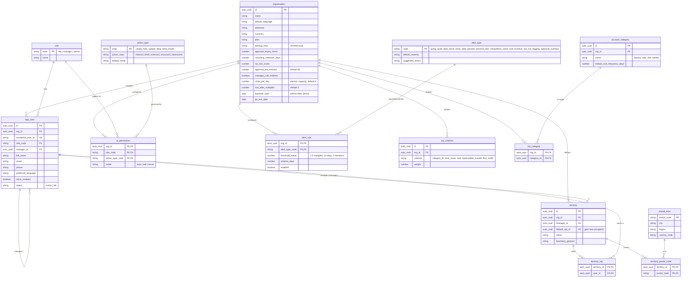
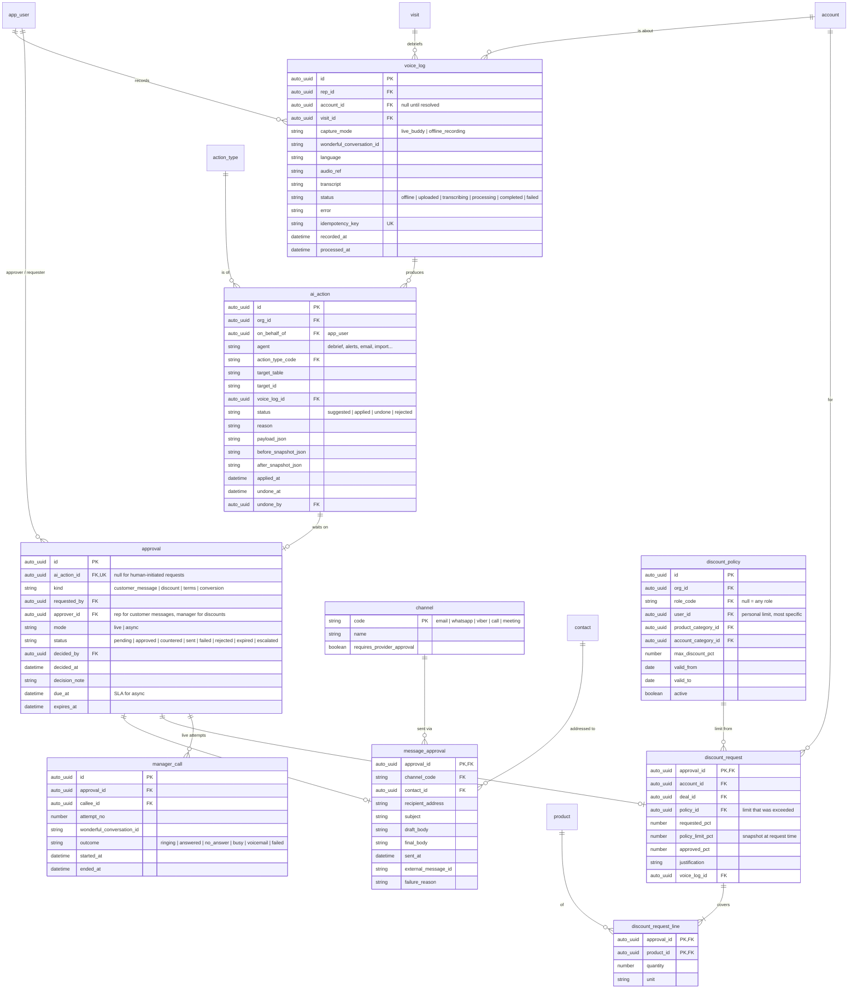
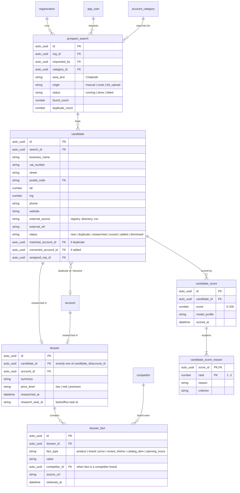
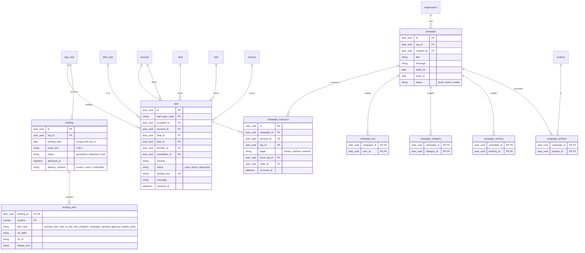
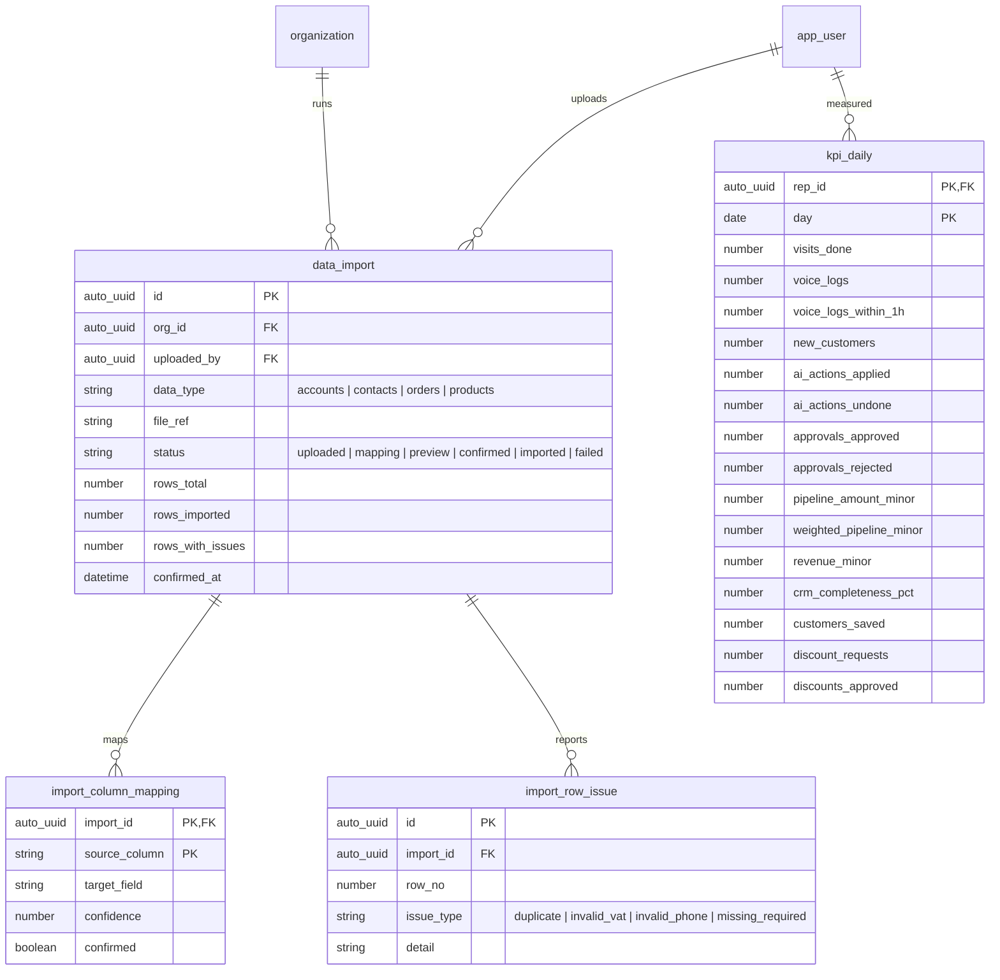
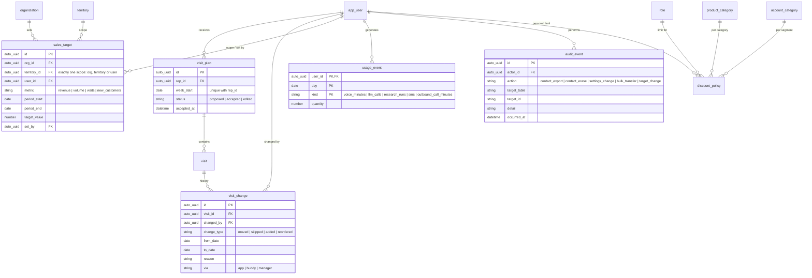

# Merc: Data Model (3NF, Wonderful Tables)

> Storage: **Wonderful Tables**, all tables in schema **`merc`** (foreign keys only work inside one schema).
> Normal form: **3NF**. Every non-key column depends on the key, the whole key, and nothing but the key.
> Diagrams split by domain. Full column specs in §3.

---

## 1. Platform constraints that shape the model

| Constraint (Wonderful Tables) | Decision |
|---|---|
| Types: `string, number, boolean, date, datetime, auto_uuid, auto_inc_id, vector, big_vector, raw_vector` | PKs are `auto_uuid`; FK columns are `auto_uuid` too (must match the key type). `number` is a double, so money is stored as **integer minor units** (`*_minor`, cents) with the currency on `organization`. |
| FKs only within the same schema; always target the PK | Everything lives in `merc`. Composite PKs used for pure link tables. |
| No enum / check constraints | Status values are `string`, validated by the Functions layer. Values that carry **their own attributes** get a lookup table (`role`, `deal_stage`, `action_type`, `alert_type`, `channel`). |
| `created_at` / `updated_at` are automatic (epoch ms) | Not repeated in specs below. Domain times (e.g. `occurred_at`, `due_at`) are explicit `datetime`. |
| Max 50 columns, 10 indexes per table | Comfortably within limits. Index every FK used in filters + main status/date filters. |
| No JSON type | Snapshots/payloads stored as `string` (JSON text). These are opaque audit blobs, not queried attributes, so 3NF holds. |
| Org isolation | **Workspace = organization.** `org_id` kept only on top-level entities so the model also works single-workspace multi-tenant; child rows inherit org through their parent (no duplicated `org_id` = no transitive dependency). |

### Derived data (deliberate, outside the 3NF core)
These are **rollups recomputed by cron**, never edited, never the source of truth: `account_metrics`, `kpi_daily`. Things like an account's usual order frequency, last order date, risk score, order totals are **not** stored on core rows because they are derivable.

---

> **Key convention (normative, supersedes the ERDs below):** every table has a surrogate `id auto_uuid` PK; the composite PKs drawn in the ERDs are implemented as **unique indexes** on the same columns. Lookup tables are keyed by a string `code`. Exact columns live in `../spec/contracts/tables/`.

## 2. ER diagrams

### 2.1 Organization, people, territories, access

### 2.2 CRM core

```mermaid
erDiagram
    account_category ||--o{ account : classifies
    postal_area ||--o{ account : locates
    territory ||--o{ account : contains
    app_user ||--o{ account : owns
    account ||--o{ contact : has
    account ||--o{ deal : has
    account ||--o{ sales_order : places
    account ||--o{ visit : receives
    account ||--o{ activity : logs
    account ||--o{ task : "relates to"
    account ||--o{ problem : has
    account ||--o{ competitor_signal : reports
    account ||--o{ account_assignment_history : "transferred via"
    account ||--|| account_metrics : "derived rollup"
    deal_stage ||--o{ deal : "is at"
    deal ||--o{ deal_stage_history : tracks
    deal ||--o{ sales_order : "results in"
    sales_order ||--|{ order_line : contains
    product ||--o{ order_line : "ordered as"
    product_category ||--o{ product : groups
    competitor ||--o{ competitor_signal : about
    contact ||--o{ activity : "with"

    account {
        auto_uuid id PK
        auto_uuid org_id FK
        string name
        string account_type "prospect | customer | lost"
        auto_uuid category_id FK
        string vat_number UK
        string street
        string postal_code FK
        number lat
        number lng
        string phone
        string email
        string website
        auto_uuid territory_id FK
        auto_uuid owner_rep_id FK
        string source "manual | import | prospecting | erp"
        date customer_since
        number visit_frequency_days "override of category default"
    }
    contact {
        auto_uuid id PK
        auto_uuid account_id FK
        string full_name
        string role_title
        string phone
        string email
        boolean is_decision_maker
    }
    deal_stage {
        string code PK "new, qualified, proposal, negotiation, won, lost"
        number sort_order
        boolean is_closed
        boolean is_won
        number probability "0-1, for weighted pipeline"
    }
    deal {
        auto_uuid id PK
        auto_uuid account_id FK
        auto_uuid owner_id FK
        string stage_code FK
        string title
        number amount_minor
        date expected_close_date
        string next_step
        datetime last_activity_at
        datetime closed_at
    }
    deal_stage_history {
        auto_uuid id PK
        auto_uuid deal_id FK
        string from_stage_code FK
        string to_stage_code FK
        auto_uuid changed_by FK
        auto_uuid ai_action_id FK
        datetime changed_at
    }
    product_category {
        auto_uuid id PK
        auto_uuid org_id FK
        string name
    }
    product {
        auto_uuid id PK
        auto_uuid org_id FK
        auto_uuid category_id FK
        string sku UK "unique per org"
        string name
        number list_price_minor
        boolean active
    }
    sales_order {
        auto_uuid id PK
        auto_uuid account_id FK
        auto_uuid deal_id FK
        auto_uuid rep_id FK
        string status "draft | confirmed | cancelled"
        string source "manual | voice | erp | import"
        date order_date
        auto_uuid voice_log_id FK
    }
    order_line {
        auto_uuid order_id PK, FK
        number line_no PK
        auto_uuid product_id FK
        number quantity
        string unit "kg, piece, box"
        number unit_price_minor
        number discount_pct
    }
    visit {
        auto_uuid id PK
        auto_uuid account_id FK
        auto_uuid rep_id FK
        date planned_date
        number route_position
        string status "planned | done | skipped"
        auto_uuid plan_id FK
        string origin "plan | manual | buddy | manager | calendar | alert"
        string purpose
        string outcome
        string skip_reason
        datetime started_at
        datetime completed_at
    }
    activity {
        auto_uuid id PK
        auto_uuid account_id FK
        auto_uuid actor_user_id FK
        auto_uuid contact_id FK
        auto_uuid visit_id FK
        auto_uuid voice_log_id FK
        string activity_type "visit | call | email | message | note | rehearsal"
        string source "human | ai | connection"
        string body
        datetime occurred_at
    }
    task {
        auto_uuid id PK
        auto_uuid account_id FK
        auto_uuid owner_id FK
        auto_uuid deal_id FK
        string title
        boolean is_customer_promise
        datetime due_at
        string status "open | done | cancelled"
        string source "human | ai"
        auto_uuid voice_log_id FK
    }
    problem {
        auto_uuid id PK
        auto_uuid account_id FK
        string description
        string status "open | in_progress | resolved"
        date due_date
        datetime resolved_at
        auto_uuid voice_log_id FK
    }
    competitor {
        auto_uuid id PK
        auto_uuid org_id FK
        string name UK
    }
    competitor_signal {
        auto_uuid id PK
        auto_uuid account_id FK
        auto_uuid competitor_id FK
        auto_uuid reported_by FK
        string statement
        number price_delta_pct
        datetime observed_at
        auto_uuid voice_log_id FK
    }
    account_assignment_history {
        auto_uuid id PK
        auto_uuid account_id FK
        auto_uuid from_rep_id FK
        auto_uuid to_rep_id FK
        auto_uuid transferred_by FK
        datetime transferred_at
        string reason
    }
    account_metrics {
        auto_uuid account_id PK, FK
        number avg_order_interval_days
        date last_order_date
        number days_since_last_order
        number risk_score
        string risk_reasons
        datetime computed_at
    }
```

### 2.3 Voice, AI actions, approvals

### 2.4 Prospecting

### 2.5 Engagement: briefings, alerts, campaigns

### 2.6 Import + reporting rollups

---

### 2.7 Planning, targets, usage, governance

---

## 3. 3NF justification (the checks reviewers ask about)

| Possible violation | How it's avoided |
|---|---|
| `account.city` depends on `postal_code`, not on account (transitive) | City/region live in `postal_area`; account holds only `postal_code` |
| `action_class` depends on the action type, not on the permission row | `action_type` lookup; `ai_permission` holds only `mode` |
| Deal stage properties (`is_closed`, `is_won`, order) repeated on each deal | `deal_stage` lookup |
| Order total stored on `sales_order` | Derived: Σ `order_line.quantity × unit_price_minor × (1 − discount)` |
| Multi-valued: territory postal codes, campaign targets, ICP categories | Link tables with composite PKs |
| Account "territory" on competitor signals for competition-wave alert | Derived via `competitor_signal.account_id → account.territory_id`; not copied |
| `org_id` on every row | Only on root entities; children reach the org through FKs |
| Dossier "competitor brands" as a comma list | One `dossier_fact` row per fact, with `source_url` + `retrieved_at` (also satisfies spec 03-D rule) |
| Score reasons as a list column | `candidate_score_reason` (score_id, rank) |
| Usual order frequency, last order, risk on `account` | Derived rollup `account_metrics` (rebuilt hourly) |
| Customer memory | Owned by Wonderful Customer Memory, keyed by `account.id`; not duplicated in tables |
| One `approval` table holding email fields **and** discount fields (most would be null, and they depend on the kind) | Supertype `approval` + subtype tables `message_approval` and `discount_request`, keyed by `approval_id` |
| Discount % repeated on each request line | One `requested_pct` / `approved_pct` per request; lines hold only product + quantity |
| The limit in force changes later and rewrites history | `discount_request.policy_limit_pct` is a **snapshot of a past fact** (the limit at request time), not a copy of a current value |
| Target progress stored on `sales_target` | Derived from orders / visits on read (or from `kpi_daily`) |
| Visit history overwritten when a visit moves | `visit_change` keeps every move/skip with reason |

**Accepted, documented exceptions**
- `deal.last_activity_at`: denormalized cache for the "deal stuck" alert and index; updated by the same function that writes the activity. Can be dropped and derived if write contention becomes a problem.
- `*_json` snapshot columns on `ai_action`: opaque audit payloads, never filtered on.
- Polymorphic refs (`ai_action.target_table/target_id`, `briefing_item.ref_table/ref_id`): no FK possible across arbitrary tables. Integrity enforced in the Functions layer.

---

## 4. Indexes (per table, beyond PK and `created_at`)

| Table | Indexes |
|---|---|
| `app_user` | `wonderful_user_id` (unique), `org_id`, `manager_id` |
| `account` | `owner_rep_id`, `territory_id`, `(org_id, vat_number)` unique, `postal_code`, `account_type`, text-search on `name` |
| `contact` | `account_id`, `email`, `phone` |
| `deal` | `account_id`, `owner_id`, `(stage_code, last_activity_at)`, `expected_close_date` |
| `sales_order` | `(account_id, order_date)`, `rep_id`, `status` |
| `order_line` | `product_id` |
| `visit` | `(rep_id, planned_date, route_position)`, `account_id` |
| `activity` | `(account_id, occurred_at)`, `actor_user_id`, `voice_log_id` |
| `task` | `(owner_id, status, due_at)`, `account_id` |
| `problem` | `(account_id, status)` |
| `competitor_signal` | `(competitor_id, observed_at)`, `account_id` |
| `voice_log` | `(rep_id, status)`, `idempotency_key` unique, `account_id` |
| `ai_action` | `voice_log_id`, `(on_behalf_of, status)`, `target_id` |
| `approval` | `ai_action_id` unique, `(status, expires_at)`, `decided_by` |
| `alert` | `dedupe_key` unique, `(recipient_id, status)`, `account_id` |
| `briefing` | `(rep_id, briefing_date)` unique |
| `candidate` | `search_id`, `status`, `vat_number`, `website`, `assigned_rep_id` |
| `dossier_fact` | `dossier_id`, `fact_type` |
| `campaign_exposure` | `(campaign_id, stage)`, `account_id` |
| `kpi_daily` | `day` |
| `discount_policy` | `(org_id, role_code)`, `user_id`, `active` |
| `discount_request` | `account_id`, `deal_id` |
| `approval` (added) | `(approver_id, status, due_at)`, `kind` |
| `manager_call` | `approval_id` |
| `visit_plan` | `(rep_id, week_start)` unique |
| `visit_change` | `visit_id` |
| `sales_target` | `user_id`, `territory_id`, `(period_start, period_end)` |
| `audit_event` | `(target_table, target_id)`, `actor_id` |

---

## 5. Seed data for the demo (J1, Athens food/beverage distributor)

| Entity | Rows |
|---|---|
| organization | 1 (Greek, Europe/Athens, EUR, briefing 07:45) |
| app_user | Nikos (rep), Eleni (manager, 12 reps: seed 4–6), Thanasis/CEO (admin) |
| territory | North, Center, South + postal codes of Chalandri, Marousi, Kifisia, Kolonaki |
| account | ~40: Miltos (open grinder problem), Bistro Lofos (no order in 12 days vs usual 7), Café Avra (prospect, website + dossier), the rest realistic |
| sales_order + lines | 6 months history so `going_quiet` fires from real math |
| product | ~25 (coffee, espresso blend, syrups, cups) incl. "new espresso coffee" for J2 campaign |
| competitor | 3 names, signals in North to trigger a competition wave |
| deal | ~15 across stages, one past close date, one stuck 14+ days |
| visit | Nikos's 5 stops for demo day |
| candidate list | "bakeries, Chalandri": 18 rows (5 duplicates) via CSV fallback |
| ai_permission | defaults from spec 02 |
| alert_rule | defaults from spec 03-E |
| discount_policy | rep 3% overall, manager 10%, coffee category for cafés 5% (so the demo shows both "within limit" and "call Eleni") |
| sales_target | Nikos November: €18,000 revenue, 110 visits; North territory €120,000 |
| visit_plan | Nikos's current week, accepted |
| baseline | `baseline_start` = 3 months before `go_live_date`, with imported visits/orders for that period |

---

## 6. Metric and rule definitions (single source for code, dashboard and pitch)

| Metric / rule | Definition |
|---|---|
| **Discount limit** | Most specific active `discount_policy` wins: user → role + product category + account category → role + product category → role. No policy = 0% (everything needs approval). |
| **CRM completeness** | % of a rep's active accounts with all core fields: category, phone or email, postal code, owner, ≥ 1 contact marked decision maker; and every open deal has amount + expected close date. Daily in `kpi_daily`. |
| **Customers saved** | A `going_quiet` alert opened at *t*, followed by a confirmed order from the same account within 30 days. Counted in the month of the order. |
| **Campaign shown** | Account's card opened, or campaign item in the rep's briefing, during the campaign window. Max one per account per rep per day. |
| **Campaign pitched** | Debrief extraction returns the campaign id with an evidence quote from the rep's words. |
| **Campaign ordered** | Confirmed order line with a campaign product, for an account with a `pitched` exposure, between the pitch date and `ends_on` + 7 days. |
| **Lost customer** | No order for more than `lost_after_multiplier` × usual frequency (minimum 60 days) → `account_type = lost` by `account-lifecycle` (internal, undo). |
| **Weighted pipeline** | Σ open deal `amount_minor` × `deal_stage.probability`. |
| **Target progress** | Revenue = Σ confirmed order lines in the period for the scope; visits = visits `done`; new customers = accounts with `customer_since` in the period. |
| **Visit overdue** | Days since last `done` visit > account `visit_frequency_days` (or category default). |
| **Rep not logging** | Rep with ≥ 1 visit planned and 0 voice logs for 2 working days → alert to the manager. |
| **Before / after** | Same metric over `baseline_start`…`go_live_date` vs the same-length period after go-live. |
