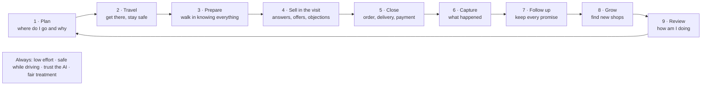

# The rep's needs: decomposition and coverage check

> We list what a field rep actually needs, starting from their job rather than from the spec, then check each need against the spec (`merc-business-spec/`) and our docs (`00`–`03`).
> **Legend:** ✅ covered · 🟨 partly covered · ❌ missing · 🚫 explicitly out of scope in the spec

---

## Decisions (2026-11-15)
| Gap | Decision | Where it lives now |
|---|---|---|
| G1 Discount approval | **3 tiers:** within the rep's policy limit → allowed on the spot. Above → the buddy **calls the manager** (outbound voice agent `merc-approver`), the manager decides by voice, the buddy relays it to the rep during the visit. No answer → async inbox + SMS, the rep gets the answer within ~1 h (or next day), then escalation | Architecture §6.6, data model `discount_policy`, `discount_request`, `manager_call`, tasks 3b.1a–f |
| G2 Visit planning | In scope: weekly suggested plan + move / skip / add by voice | Architecture §6.7, `visit_plan`, `visit_change`, tasks 3b.2a–c |
| G3 Buddy tools | All added to the contract | Architecture §4, task 3b.3 |
| G4 Targets | In scope | `sales_target`, task 3b.8 |
| G5–G12 | Still open (see questions §5) | |

## 1. The rep's job in one line

**Hit my sales target, keep my customers, and win new ones, while spending as little time and attention as possible on anything that isn't selling.**

That breaks into a cycle the rep repeats every day, plus a few needs that apply all the time:

---

## 2. Decomposition and coverage

### 1 · Plan: "Where do I go today, and why?"
| Need | Spec | Our docs | Coverage |
|---|---|---|---|
| See today's stops in order with a reason for each | 03-B briefing, 07 Today screen | `briefing-get`, `today-get` | ✅ |
| **Someone or something builds the week's visit plan** (which customers to see this week) | Not described. Stops come from calendar or existing visits. Route optimization is P2 | `visit` table exists, no planning function | ❌ |
| Know which customers are overdue for a visit (not only for an order) | Only "not ordering" alert | — | ❌ |
| Add, skip or reschedule a stop, also by voice ("move Lofos to Thursday") | Visit states planned → done / skipped, but no flow | No function or buddy tool | ❌ |
| Know the shop's opening hours / best time to visit | Not for existing customers | Only as a prospect `dossier_fact` | 🟨 |
| See the stops on a map | 07 Today: map | Today screen | ✅ |
| Get the briefing hands-free in the morning | 03-B: screen, voice, notification | cron + buddy skill | ✅ |

### 2 · Travel: "Get there and stay safe."
| Need | Spec | Our docs | Coverage |
|---|---|---|---|
| One tap to navigate to the next stop (open Google Maps / Waze) | Not mentioned | — | ❌ (small) |
| **Talk to the buddy without touching the phone while driving** | Implied ("the rep is driving") | Browser voice needs a tap to start; no wake word in a browser | 🟨 risk |
| Short voice answers | 06 rule 5 | buddy prompt (4.9) | ✅ |
| Phone battery and mobile data don't run out | Not mentioned | — | ❌ (NFR) |

### 3 · Prepare: "Walk in knowing everything."
| Need | Spec | Our docs | Coverage |
|---|---|---|---|
| Customer history, open problems, recent orders, risk | 03-C | `visit-card-get` | ✅ |
| Products that suit them and why, plus active campaigns | 03-C, 03-J | visit card + Context Hub | ✅ |
| How to talk to this person | 03-C, 06 memory | customer memory | ✅ |
| Prospect dossier and pitch | 03-C, 03-D | `merc-research`, visit card | ✅ |
| Rehearse the pitch | 03-C (P1) | 4.10 | ✅ |
| **Who the contacts are and who decides** | 05 Contact entity | `contact` table, not on the card | 🟨 |
| **What they owe us** (balance, overdue invoices, credit limit) | Not mentioned. CPQ / invoicing out of scope | — | ❌ important in Greek distribution |

### 4 · Sell in the visit: "Answer anything on the spot."
| Need | Spec | Our docs | Coverage |
|---|---|---|---|
| Ask the buddy a free question ("when did Miltos last order the espresso blend?") | 06 Buddy "answers" | No general question tool in the buddy contract | 🟨 |
| Product info and price | 05 Product: code, category, price | `product` table, no buddy tool | 🟨 |
| **Is it in stock / when can it be delivered** | Not mentioned | — | ❌ |
| **Customer-specific prices / agreed terms** | Not mentioned | `list_price` only | ❌ |
| **How much discount can I give, and who approves more** ("20 kilos if we give him 5%") | Not mentioned. J1 shows the 5% ask, but no approval path | Our approvals only cover AI → customer messages | ❌ important |
| Handle objections | 03-C pitch with objections | visit card + Context Hub | ✅ |
| Send a catalog or price list on the spot | Not mentioned | — | ❌ (small) |

### 5 · Close: "Take the order and get it delivered and paid."
| Need | Spec | Our docs | Coverage |
|---|---|---|---|
| Draft an order from voice, confirm it | 03-A, 02 draft = auto | `sales_order` status draft → confirmed | ✅ |
| **The confirmed order reaches the warehouse / ERP** | ERP: file import of history only; direct connection P2 | Nothing sends orders out | ❌ |
| Order and delivery status ("where's my delivery?") | Not mentioned | — | ❌ |
| Collect payment or log a payment | Not mentioned | — | ❌ / maybe 🚫 |
| Returns and complaints | 03-A problems | `problem` | ✅ |
| Convert prospect to customer | 02 structural = approval | `account-convert` | ✅ |

### 6 · Capture: "Record what happened without typing."
| Need | Spec | Our docs | Coverage |
|---|---|---|---|
| 30–60 s free speech updates everything | 03-A | debrief | ✅ |
| Works with no signal | 03-A, 07 | offline queue | ✅ |
| Greek, English, mixed | 03-A | golden set | ✅ |
| Never invents numbers, asks when unsure | 03-A, 06 | 2.6, 2.7 | ✅ |
| See what was done and undo any line | 03-A | result card + undo | ✅ |
| **New contact from speech** ("met the new manager Maria, her number is…") | 02 lists "customer details update", but 03-A extraction doesn't list contacts | Extraction schema has no contacts | 🟨 |
| Mark the visit done automatically after a debrief | Visit states, no rule | — | 🟨 |
| Photos (shelf, display, broken equipment) | Not mentioned | — | ❌ (P2) |
| Log a phone call the rep made | 05 Activity: call | Only via voice debrief | 🟨 |
| Samples given | J1 learning "with bakeries the sample works", not modeled | — | ❌ (small) |

### 7 · Follow up: "Never drop a promise."
| Need | Spec | Our docs | Coverage |
|---|---|---|---|
| Tasks with reminders from what I said | 03-A | `task` + alerts | ✅ |
| Drafted emails in my style, sent from my account after I approve | 03-A, 03-F, 02 | approvals + Integration Hub per-user | ✅ (S3 risk) |
| Approve by voice | 03-F | buddy skill 4.6 | ✅ |
| Alerts: going quiet, deal stuck, close date passed, promise due | 03-E | `alerts-engine` | ✅ |
| **WhatsApp / Viber** (how Greek reps really talk to shops) | 03-M: P2 | ✂️ | 🚫 risk for adoption |
| Book a meeting in the customer's calendar | 02 external | Calendar P1 | 🟨 |

### 8 · Grow: "Find new shops without searching."
| Need | Spec | Our docs | Coverage |
|---|---|---|---|
| Find, dedupe, research and score shops in my area | 03-D | prospecting pipeline | ✅ |
| New shop near my route | 03-B | 5.9 | ✅ |
| Add to route / dismiss | 03-D | `candidate-act` | ✅ |
| Add a shop I spotted on the street, by voice | Not described | — | ❌ (small) |

### 9 · Review: "How am I doing?"
| Need | Spec | Our docs | Coverage |
|---|---|---|---|
| End of day summary and what to start with tomorrow | 03-G (P1) | 3.16 | ✅ |
| My personal numbers | 02 rep dashboard: personal numbers | `kpi_daily` | 🟨 |
| **My target / quota and how far I am from it** | Not mentioned | No target entity | ❌ important |
| Commission / bonus | Not mentioned | — | ❌ / maybe 🚫 |
| Learn what works | 03-G "the system learned", 03-N P2 | — | 🟨 |

### Always: "Low effort, fair, trustworthy."
| Need | Spec | Our docs | Coverage |
|---|---|---|---|
| One hand, everything also by voice | 07 NFR | rep screens + buddy tools | 🟨 several actions have no buddy tool (see §3) |
| Control what the AI does on its own | 02 (admin sets it) | `ai_permission` | 🟨 the rep can't set personal preferences |
| Nothing goes to a customer without my OK | 02 | autonomy engine + governance | ✅ |
| **Location privacy**: "nearest customer" needs GPS; is management tracking me? | Not addressed | `account-resolve(lat, lng)`, not stored | ❌ GDPR question |
| My customers and history follow me / follow my replacement | 02 | bulk transfer + account memory | ✅ |
| Control notifications (no pings during a visit) | Not mentioned | — | ❌ (small) |
| Expenses / mileage | Not mentioned | — | ❌ / probably 🚫 |
| Fast (< 20 s), reliable | 07 NFR | 2.8, 7.1 | ✅ |

---

## 3. Buddy tools missing for "everything by voice"

The buddy tool contract in `01-architecture.md` §4 doesn't cover these spoken requests:

| The rep says | Missing tool |
|---|---|
| "Move Lofos to Thursday" / "Skip Avra today" / "Add Miltos tomorrow" | `update_visit(visit_id, action, date?)` |
| "When did Miltos last order the espresso?" / "What's open with Lofos?" | `ask_crm(question, account_id?)`, read-only, numbers from queries only |
| "How much is the 1 kg espresso?" / "Is it in stock?" | `product_lookup(query)` |
| "Remind me to call Maria on Monday" (without a visit) | `create_task(...)` |
| "There's a new bakery on Ermou street, add it" | `add_candidate(name, location)` |
| "How am I doing this month?" | `my_performance(period)` |

---

## 4. Gaps ranked

| # | Gap | Why it matters | Proposal | Priority |
|---|---|---|---|---|
| G1 | **Discount / terms approval by the manager** | J1's own example (5% for 20 kg) has no path. A rep can't commit without it | New approval kind "internal approval": rep → manager, reusing the `approval` table with an `approver_id` | P0 (demo moment) |
| G2 | **Visit planning and rescheduling** | The briefing assumes stops exist. Nothing creates or changes them | Weekly "suggested visits" job (overdue + at-risk + campaigns + prospects) + `update_visit` tool | P0 (light), P1 full |
| G3 | **Free questions to the buddy** (`ask_crm`, `product_lookup`) | "Buddy that knows every customer" breaks if it can only read pre-built cards | Read-only query tools; numbers come only from rows | P0 |
| G4 | **Targets / quota** | Reps think in "how far am I from my number". The manager's coaching depends on it | `sales_target` table (rep, period, amount/visits) + progress in briefing and end of day | P1 |
| G5 | **Confirmed order → ERP / warehouse** | Without it the rep still has to phone the order in, which is double work | MVP: export file or email to back office on confirm. P2: direct ERP | P1 |
| G6 | **Balance / overdue / credit limit on the card** | In Greek distribution reps often collect money and must know if a shop is blocked | Read-only from ERP file import: `account_balance` snapshot | P1 (ask Thanasis) |
| G7 | **Contacts from the debrief** | People change jobs. Missing contacts break "email the owner" | Add `contacts` to the extraction schema (internal, auto + undo) | P0 (small) |
| G8 | **Hands-free while driving** | Safety, and the core "you talk, you don't type" promise | Big 🎤 that stays open for the whole drive; confirm whether Wonderful offers a phone-call channel to the same buddy as a fallback | P0 spike |
| G9 | **Location consent and use** | GDPR. Unions and reps may reject tracking | Location only on the phone, sent per request, never stored or shown to management. Write it in settings | P0 (decision) |
| G10 | **Stock / delivery status** | Common question from shops | Out of the MVP unless the ERP export includes it | P2 |
| G11 | Navigate to stop, notifications control, samples, photos, add-shop-by-voice | Quality of life | Small items | P1/P2 |
| G12 | WhatsApp/Viber | Real channel in Greece | Already P2 in the spec. Flag it as an adoption risk in the pitch | P2 |

---

## 5. Questions for Thanasis (product owner)

1. Who decides the week's visits today: the rep, the manager, or a fixed rotation per customer? (G2)
2. How much discount can a rep give alone, and who approves above that? (G1)
3. Do reps in our target industries collect payments or check credit? (G6)
4. Do reps have monthly targets, and are they in revenue, volume or visits? (G4)
5. How do orders reach the warehouse today: phone, email, ERP terminal? (G5)
6. Is location tracking acceptable to customers' reps and management, or only on-device use? (G9)
