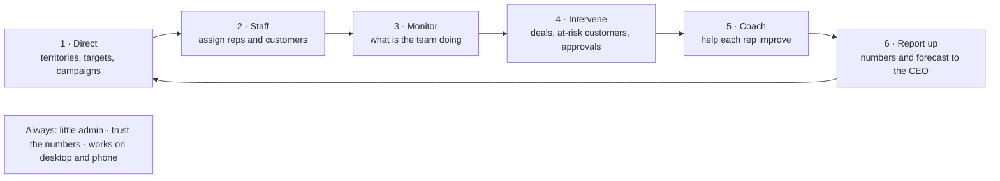
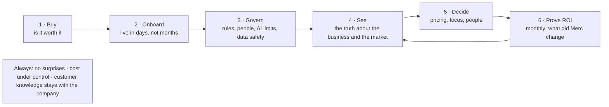

# Manager and CEO needs: decomposition and coverage check

> Same method as [`04-rep-needs.md`](04-rep-needs.md): we start from each person's job, list their needs, then check each need against the spec (`merc-business-spec/`) and our docs (`00`–`04`).
> **Legend:** ✅ covered · 🟨 partly covered · ❌ missing · 🚫 explicitly out of scope in the spec

---

## Decision (2026-11-15)
**All gaps M1–M15 accepted.** Data model changes are applied in `02-data-model.md` (§2.7 and the metric definitions in §6); functions and cron jobs are in `01-architecture.md` §5; tasks are in `03-progress.md` Phase 6b. The manager also gets a new job from G1: **approving discounts by phone or from the inbox** (architecture §6.6).

---

# Part A: Sales Manager (Eleni, 12 reps)

## A1. The job in one line
**Make the team hit its target: point the reps at the right customers, see early who or what is slipping, and step in before it costs a sale.**

## A2. Decomposition and coverage

### 1 · Direct: "Point the team at the right work."
| Need | Spec | Our docs | Coverage |
|---|---|---|---|
| Define territories (map drawing or postal codes) | 03-I (P1) | `territory`, `territory_postal_code`, `boundary_geojson`; task 6.7 builds postal codes only | 🟨 no map drawing |
| Write a campaign in plain words with targets and dates | 03-J (P1) | `campaign` + target link tables, CRUD form (6.5) | 🟨 no natural-language entry ("push product X to bakeries this week") |
| Campaign shows up in briefings and cards | 03-J, J2 | 6.6, briefing builder | ✅ |
| **Set team and rep targets** (revenue, volume, visits) | Not in spec | G4 from rep needs, P1 | ❌ |
| Set the ICP for their team's prospecting | 03-D (admin defines ICP) | `icp_*` tables per org | 🟨 org-wide only, not per team |
| Tune AI rules for the team | 02 "only what concerns the team (suggestion)" | `ai_permission` is per org × role | 🟨 no team scope |

### 2 · Staff: "Right rep on the right customers."
| Need | Spec | Our docs | Coverage |
|---|---|---|---|
| Assign reps to territories | 03-I | `territory_rep` | ✅ |
| Bulk transfer when a rep leaves, with full history and memory | 02, 03-I, J2 | `assignments-transfer`, `account_assignment_history`, memory keyed by account | ✅ |
| Reassign one customer or one prospect | Implied | `account-upsert`, `candidate-act` | ✅ |
| **New prospecting customers go automatically to the territory's rep** | 03-I rule | Not written as a rule; a territory can have several reps, so "which rep" is undefined | 🟨 |
| Onboard a new rep (invite, territory, connect email/calendar) | 02, 03-L | `users-*`; per-user Integration Hub connect flow not described | 🟨 |

### 3 · Monitor: "What's happening right now?"
| Need | Spec | Our docs | Coverage |
|---|---|---|---|
| Team dashboard: visits/day per rep, pipeline by stage, new customers, at-risk, completeness, adoption, AI approved/rejected | 03-H (P1) | `dashboard-kpis`, `kpi_daily` (6.1–6.3) | 🟨 see next rows |
| **CRM completeness** metric | 03-H, 01 KPI ≥ 90% | Not defined ("core fields" unspecified), not in `kpi_daily` | ❌ |
| Adoption: logs per rep/day, % logged within 1 h | 03-H, 01 KPI ≥ 80% | `kpi_daily.voice_logs`, `voice_logs_within_1h` | ✅ |
| Filters: territory, rep, period | 03-H | 6.3 | ✅ |
| Drill down from a number to the list behind it (which 7 customers are at risk?) | J2 "7 at-risk customers in the North" | Customers/Pipeline screen exists, no link from KPI to filtered list | 🟨 |
| Competition wave alert | 03-E (to manager) | `alerts-engine`, `competition_wave` | ✅ |
| **See all competitor signals** (who, where, what price) | 03-E, 03-N Market Radar P2 | Rows exist in `competitor_signal`, no screen | 🟨 |
| **Alert when a rep stops logging** | J2 notices it on the dashboard | No alert, only the dashboard | 🟨 |
| Use it on the phone too | 02 "Desktop (and mobile)" | Management shell is desktop only | 🟨 |

### 4 · Intervene: "Step in before it costs a sale."
| Need | Spec | Our docs | Coverage |
|---|---|---|---|
| See stuck deals and passed close dates across the team | 03-E (alerts go to the rep) | Alerts have one `recipient_id` (the rep); no team alert view | 🟨 |
| **Approve discounts / special terms** | Not in spec | G1 from rep needs (3b.1) | ❌ (planned) |
| Act on an at-risk customer (assign a visit, call them) | Implied by J2 | No "create a visit/task for rep X" from the manager screen | 🟨 |
| Receive escalations from reps ("Miltos wants to talk to the manager") | Not in spec | — | ❌ (small) |

### 5 · Coach: "Help each rep get better."
| Need | Spec | Our docs | Coverage |
|---|---|---|---|
| See one rep's activity: visits, notes, debriefs | 02 visibility: team's deals, visits, notes | Data allowed, no rep-detail screen | 🟨 |
| Compare reps fairly (per territory size, customer count) | Not in spec | `kpi_daily` per rep, no normalisation | 🟨 |
| See which pitches/campaigns work for whom | 03-J funnel, 03-G "system learned" | Funnel only per campaign | 🟨 |
| Listen to / read a rep's debrief | Not in spec | Transcript stored; audio deleted after 30 days | 🟨 privacy decision |

### 6 · Report up: "Tell the CEO where we stand."
| Need | Spec | Our docs | Coverage |
|---|---|---|---|
| Weekly summary: what closed, what got stuck, what's coming | 06 Weekly summary agent | `weekly-summary` cron + `merc-ops` (6.12) | ✅ |
| **Forecast** (weighted pipeline) | Not in spec | `deal_stage` has no win probability | ❌ (cheap: add `probability`) |
| Campaign results: shown → pitched → ordered | 03-J, J2 | `campaign_exposure` | 🟨 see the next row |
| **Detect "pitched" from the voice log** | 03-J "measured from the voice logs" | The debrief extraction schema (2.5) has no campaign field | ❌ |
| **Define "ordered" for a campaign** | 03-J | No rule (which products, which time window) | ❌ |

---

# Part B: CEO / Admin (the buyer)

## B1. The job in one line
**Grow revenue and keep customers, decide with real market data, and get a clear return on what the company pays for Merc, with no risk to the business.**

## B2. Decomposition and coverage

### 1 · Buy: "Is this worth it?"
| Need | Spec | Our docs | Coverage |
|---|---|---|---|
| A live demo of a rep's day + the dashboard | J3.1 | Demo plan 7.6–7.11 | ✅ |
| **One KPI that makes them sign** | 01, 08 open question | Q1, unanswered | ❌ open |
| Price per rep that fits the ROI | 01, 08 open | Not our scope for the hackathon | 🟨 |
| **Before/after baseline** ("visits ↑ compared to before") | 01 KPIs | No baseline captured at import; "before" numbers don't exist | ❌ |

### 2 · Onboard: "Live in days."
| Need | Spec | Our docs | Coverage |
|---|---|---|---|
| Upload customers/orders Excel → CRM full in minutes | 03-K, J3.2 | `import-pipeline`, preview + confirm (6.11) | ✅ |
| Import report: how many went in, how many have problems | 03-K | `import_row_issue` | ✅ |
| Set ICP, briefing time, "emails always need approval" | J3.3, 03-L | Settings (6.9) | ✅ |
| Invite users, set roles and territories | 03-L | `users-*` (6.10) | ✅ |
| Products / price list import | 03-K (products) | `data_type = products` | ✅ |
| Every rep connects email and calendar | 03-M | Per-user connect flow not described | 🟨 |

### 3 · Govern: "Rules, people, AI limits, data safety."
| Need | Spec | Our docs | Coverage |
|---|---|---|---|
| AI permissions per action type and role (auto / ask / never) | 02 | `ai_permission`, Settings | ✅ |
| See everything the AI did, and undo rates | 02, 03-H | AI action log (7.2), dashboard | ✅ |
| Data isolation between companies | 02 | Workspace per org | ✅ |
| EU data, GDPR, recording retention | 07 NFR, 03-L | `retention-purge`; EU environment to confirm (0.1) | 🟨 |
| **GDPR requests for shop contacts** (export, delete a person) | Not in spec. Note: "destructive = never by the AI", but humans must be able to delete | No delete/export flow | ❌ |
| **Location / tracking policy** | Not in spec | G9 from rep needs (3b.7) | ❌ (planned) |
| Customer knowledge stays when reps leave | 01, 02 | Account-keyed memory + bulk transfer | ✅ |

### 4 · See: "The truth about the business and the market."
| Need | Spec | Our docs | Coverage |
|---|---|---|---|
| Company dashboard (same KPIs, all teams) | 03-H | `dashboard-kpis` scope `all` | ✅ |
| **Revenue** by territory, rep, category, period | Not explicit in 03-H | Derivable from `sales_order` + `order_line`, not in `kpi_daily` or the dashboard | 🟨 |
| Revenue vs target | Not in spec | No targets (G4) | ❌ |
| **Customer base health: lost customers / churn** | 01 "customers fade away", 05 state "lost" | No rule for when a customer becomes `lost`; no churn metric | ❌ |
| At-risk customers and their value | 03-H | At-risk count in the dashboard; value at risk not computed | 🟨 |
| Competition trends (who, where, price gaps) | 01 "competition spotted late", 03-N Market Radar | Signals stored; trends are P2 | 🚫 P2, simple list 🟨 |
| Margin / profitability | Not in spec | No product cost | 🚫 / ❌ (later) |

### 5 · Decide: "Pricing, focus, people."
| Need | Spec | Our docs | Coverage |
|---|---|---|---|
| Which categories / areas to push | Implied by campaigns + prospecting | Prospecting scores + campaign funnel | 🟨 |
| Which reps need help or replacing | 03-H adoption + visits | `kpi_daily` | 🟨 |
| Ask a question in plain words ("why did the North drop in October?") | Not in spec (Buddy is for reps) | No management assistant | ❌ (nice to have, strong demo) |

### 6 · Prove ROI: "What did Merc change this month?"
| Need | Spec | Our docs | Coverage |
|---|---|---|---|
| **Monthly report**: visits ↑, completeness, new customers, customers saved | J3.4 | Not in our docs. Only a weekly summary exists | ❌ |
| **"Customers saved" metric** | 01 KPI, J3.4 | No definition | ❌ |
| New customers per month from prospecting | 01 KPI | `account.source = prospecting` + `customer_since` | ✅ (derivable) |
| **AI / voice usage and cost** (minutes, research runs) | 01 usage credits | Nothing meters usage | ❌ |

---

# Part C: Gaps ranked (manager + CEO)

| # | Gap | Who | Proposal | Priority |
|---|---|---|---|---|
| M1 | **Campaign "pitched" and "ordered" are not measurable** | Manager | Add `campaigns_pitched` to the debrief extraction (active campaigns passed as context). "Ordered" = an order line with a campaign product for an exposed account between `starts_on` and `ends_on + 7 days` | P0 if J2 is in the demo, else P1 |
| M2 | **CRM completeness not defined** | Both | Define core fields (account: category, phone, address, owner; contact: ≥ 1 decision maker; deal: amount, close date). Daily % in `kpi_daily` | P1 (it's an official pilot KPI) |
| M3 | **Drill-down from KPI to list** | Manager | Every KPI tile links to the filtered Customers/Pipeline list | P1 (cheap, big demo value) |
| M4 | **Team view of alerts and stuck deals** | Manager | Manager sees team alerts read-only; "assign visit/task to rep" action | P1 |
| M5 | **Forecast** | Both | `deal_stage.probability`; weighted pipeline on the dashboard | P1 (cheap) |
| M6 | **Monthly ROI report + "customers saved"** | CEO | Saved = an at-risk alert followed by an order within 30 days. Monthly report from rollups, sent by `merc-ops` | P1 (it's J3.4) |
| M7 | **Baseline before Merc** | CEO | Import step 0: last 3 months of visits/orders as the "before" period | P1 (needed for any ROI claim) |
| M8 | **Revenue and churn on the dashboard** | CEO | Revenue from order lines; rule: customer becomes `lost` after N × usual frequency with no order (admin sets N) | P1 |
| M9 | **Targets** (team + rep) | Both | Same as G4: `sales_target` table | P1 |
| M10 | **Usage metering** | CEO / us | `usage_event` table (voice minutes, research runs, LLM calls) per user per day | P1 (pricing depends on it) |
| M11 | **GDPR: export / delete a contact** | CEO | Admin-only human action, logged | P1 |
| M12 | Prospecting auto-assignment rule | Manager | Territory has a "default rep"; otherwise least-loaded rep | P1 |
| M13 | Natural-language campaign entry | Manager | LLM turns "push X to bakeries in the North this week" into a filled form for review | P1 (good demo) |
| M14 | Management assistant ("why did the North drop?") | CEO | Read-only chat agent over rollups; numbers come only from queries (Rule A) | P2 (stretch demo) |
| M15 | Team-scoped AI rules and ICP, mobile management, map drawing, escalations, competitor list screen | Manager | Small items | P1/P2 |

## Data model changes these gaps imply
| Change | Gap |
|---|---|
| `deal_stage.probability` (number) | M5 |
| `kpi_daily` + `crm_completeness_pct`, `revenue_minor`, `customers_saved` | M2, M6, M8 |
| New `sales_target` (target_id, scope: org / territory / rep, period, metric, value) | M9 |
| New `usage_event` (user_id, day, kind, quantity) | M10 |
| `alert_rule` + `lost_after_multiplier`; `account_type` transition job | M8 |
| `territory.default_rep_id` | M12 |
| Debrief extraction: `campaigns_pitched[]` → `campaign_exposure(stage = pitched)` | M1 |

---

# Part D: Questions for Thanasis
1. Which single number would make the CEO sign: more visits, saved customers, new customers, or completeness? (Q1)
2. Should managers be able to read or listen to their reps' debriefs? (coaching vs privacy)
3. When is a customer "lost": after how long without an order?
4. Do managers set rep targets in Merc, or do targets come from the ERP?
5. Is J2 (campaign funnel) in the demo? If yes, M1 becomes P0.
