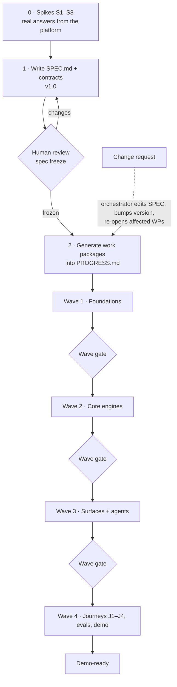
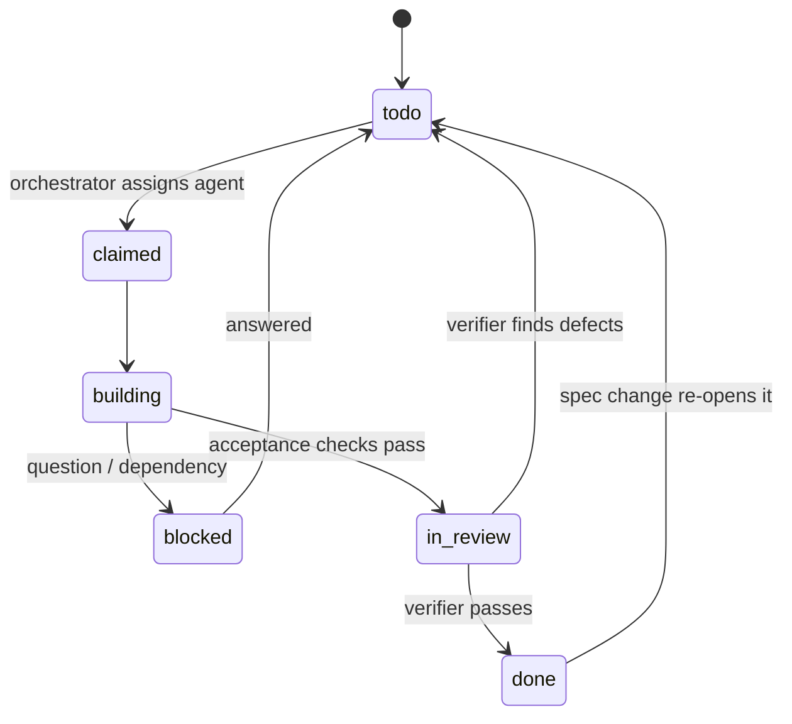

# Build methodology: spec-driven, agent-built

> How we turn the docs into a working product using coding agents.
> **Principle:** agents only build well against something precise. So we first freeze a **final spec + machine-readable contracts**, then split the work into small **work packages** tracked in one **progress file**, and run agents in **dependency waves** with independent verification at every step.

---

## 1. The artifacts (what exists, and who wins in a conflict)

| Artifact | Role | Normative? |
|---|---|---|
| `spec/SPEC.md` | **Final spec.** Every requirement as a numbered, testable statement (`REQ-DEB-004: If no price was spoken, the price field stays empty and is listed in missing_fields`). Merges docs 00–05 + business spec. | ✅ wins all conflicts |
| `spec/contracts/` | Machine-readable interfaces (below). Agents build **to** these and test **against** them. | ✅ |
| `docs/00–05` | Rationale, diagrams, decomposition. Explains *why*. | ❌ reference only |
| `docs/03-progress.md` → **`PROGRESS.md`** | The work queue and the state of every work package. Single source of "what's done". | ✅ for status |
| `merc-business-spec/` | Original business input | ❌ superseded by SPEC |

### Contracts folder
| Path | Content | Used for |
|---|---|---|
| `contracts/tables/*.json` | One file per table, in the exact **Tables API** create payload (columns, types, PK, FKs, indexes) | Table creation script, data access types |
| `contracts/functions/<slug>.json` | Method, path, gate permission, **JSON Schema** for request and response, error codes | Function code, app client, mocks, contract tests |
| `contracts/tools/<tool>.json` | Buddy / approver tool schemas → which function they call | Voice agents |
| `contracts/events/*.json` | `merc-live` WebSocket message shapes | App ↔ backend push |
| `contracts/llm/*.json` | Structured-output schemas (debrief extraction, scoring, ask-crm template choice) | Prompts + evals |
| `contracts/metrics.md` | The metric and rule definitions (data model §6), with SQL-like pseudocode | Dashboard, cron jobs, pitch |
| `contracts/seed/` | Seed data as JSON (demo org, Nikos, Miltos…) | Seed script, evals, demo |

**Why contracts first:** once a function's input/output is fixed, the app, the voice tools and the function itself can be built **in parallel** by different agents, each against generated mocks, and they fit together at the end.

---

## 2. The process



### Step 0: spikes before the spec freeze
S1–S8 can change the architecture (app on phone, voice in app, per-user Gmail, offline STT, prospect source, timeouts, outbound call to manager, relaying the decision). They run **first**, by a human with platform access or by one agent using `wful`. Each result goes into the decision log, then into SPEC.

### Step 1: write the final spec
- One section per module: `CORE` (tables, autonomy, scope), `DEB` debrief, `BRF` briefing, `CRD` visit card, `ALR` alerts, `APR` approvals, `DSC` discounts, `PLN` planning, `PRS` prospecting, `CMP` campaigns, `TGT` targets, `DSH` dashboard, `IMP` import, `SET` settings, `BUD` buddy, `APV` approver agent, `APP` app screens, `OPS` monitors/retention, `NFR`.
- Each requirement: ID, statement, priority (P0/P1/P2), **acceptance check** (how a machine or a person verifies it), source (which doc/decision).
- Anything unresolved is marked `OPEN-xx`, never guessed. Work that depends on an OPEN item is blocked, not invented.

### Step 2: work packages
A work package (WP) is the unit an agent takes. Rules:

| Rule | Why |
|---|---|
| Finishable in **one agent session** (roughly ≤ 1 function + tests, or 1 screen, or 1 agent skill) | Small context = fewer mistakes |
| **Owns** an explicit set of paths/resources; no two open WPs own the same file | No merge conflicts between parallel agents |
| Lists the **SPEC requirement IDs** and **contracts** it implements | The agent reads only what it needs |
| Has **runnable acceptance checks** | "Done" is checked, not claimed |
| Declares **depends_on** | The orchestrator schedules waves from it |

WP template (one row in PROGRESS.md + one file `wp/WP-DEB-02.md`):
```yaml
id: WP-DEB-02
title: debrief-process function
wave: 2
priority: P0
requirements: [REQ-DEB-001..012, REQ-CORE-020..025]
contracts: [functions/debrief-process.json, llm/debrief-extraction.json, events/result-card.json]
owns: [functions/debrief-process/**, evals/debrief/**]
depends_on: [WP-CORE-01 tables, WP-CORE-03 autonomy-engine, WP-CORE-05 model-profiles]
acceptance:
  - typecheck + unit tests pass
  - contract test: responses validate against functions/debrief-process.json
  - golden set evals/debrief: >= 80% pass, 100% on "no invented numbers"
  - deployed to dev workspace; smoke call on seed utterance "Miltos 20 kilos 5%" returns expected actions
  - p95 latency < 20 s on 10 runs
status: todo
```

### Step 3: waves
| Wave | Work packages (examples) | Parallel agents | Depends on |
|---|---|---|---|
| **1 · Foundations** | Table creation script + seed, shared lib (data access, `me()`, scope checks), app scaffold + routing, model profiles + LLM helper, contract-test harness + mocks, deploy scripts | 5–6 | Frozen spec |
| **2 · Core engines** | Autonomy engine + undo, debrief, approvals + dispatch, discount check/request, visit card, briefing builder, alerts engine + metrics rollup, visit planner, ask-crm templates | 6–9 | Wave 1 |
| **3 · Surfaces + agents** | Rep screens (Today, Customers, 🎤, Approvals, Alerts, New shops), management screens, `merc-buddy` tools + skills, `merc-approver`, prospecting procedure + `merc-research`, import pipeline, dashboard + KPIs, targets, campaigns | 8–12 | Wave 2 contracts (mocks allow early start) |
| **4 · Journeys + demo** | E2E J1–J4 on a real phone, eval suites, performance, monitors, demo reset script, backup video | 3–4 | Wave 3 |

Mocks generated from contracts let Wave 3 UI work start during Wave 2.

---

## 3. Agent roles

| Role | Who | Does | Does not |
|---|---|---|---|
| **Orchestrator** | Main session (this one) | Keeps SPEC and PROGRESS consistent, creates WPs, launches each wave, collects results, merges, handles change requests | Write feature code itself |
| **Builder** | One agent per WP, in its own git worktree | Reads its WP + listed SPEC/contracts, implements, runs the acceptance checks, deploys to the **dev** workspace, reports evidence | Touch files it doesn't own, change contracts, invent requirements |
| **Verifier** | Separate agent, sees the code and SPEC, **not** the builder's summary | Re-runs acceptance checks, reviews against requirement IDs, files defects as new WPs | Fix the code itself |
| **Eval runner** | Agent or CI job | Runs golden sets (debrief, buddy, approver, ask-crm) and reports pass rates per requirement | |
| **Human (you)** | Stefanos + team | Spike runs that need real accounts, spec freeze, demo-critical calls, real phone tests | |
| **Voice reviewer** | Teammate (optional) | Listens to buddy and approver eval calls and files voice-quality issues. Builder agents own `merc-buddy` and `merc-approver` end to end (prompt, skills, tools, evals). | |

### Rules every builder agent follows
1. **Contract is law.** If the contract seems wrong, stop and raise a change request; don't silently deviate.
2. **No invented requirements.** Ambiguous → mark the WP `blocked` with a question.
3. **Stay in your lane:** only owned paths and resources.
4. **Dev workspace only.** Never real customer emails/SMS/calls outside test accounts.
5. **Never delete** platform resources or data outside your own test rows.
6. **Evidence or it didn't happen:** the final report lists the commands run and their output, deployed resource IDs, and failing checks if any.

---

## 4. PROGRESS.md as the state machine



Columns per WP: `id | title | wave | priority | owner (agent/human) | status | depends_on | evidence link | updated`.
- Only the **orchestrator** writes PROGRESS.md (agents report back; no parallel edits to one file).
- Every status change and decision gets a line in the log.
- The snapshot table at the top is regenerated from the rows.

---

## 5. Quality gates

| Level | Gate |
|---|---|
| **WP** | Typecheck + lint · unit tests · contract tests (I/O validates against JSON Schema) · deployed to dev + smoke call · verifier pass |
| **Wave** | Integration test across the wave's WPs on the dev workspace with seed data · no open P0 defects |
| **LLM parts** | Eval golden sets with thresholds per requirement (e.g. "no invented numbers" = 100%, extraction ≥ 80%) run before every merge that touches prompts |
| **Release (demo)** | J1–J4 pass on a real phone, twice, from a fresh reseed · p95 debrief < 20 s · backup video recorded |

---

## 6. Repository and environments

```
merc/
  spec/SPEC.md
  spec/contracts/{tables,functions,tools,events,llm,seed}/
  PROGRESS.md
  wp/WP-*.md
  infra/            # table creation, seed, reset, deploy scripts (wful)
  shared/           # autonomy engine, scope, data access, LLM helpers
  functions/<slug>/ # one folder per HTTP / cron / WebSocket function
  procedures/       # exported procedure definitions
  agents/           # merc-buddy, merc-approver, merc-research, merc-ops (Agents V2 repos)
  app/              # React bundle: rep + management shells
  evals/            # golden sets per agent / LLM step
  tests/e2e/        # J1–J4
```

| Environment | Use |
|---|---|
| **dev workspace** | Agents deploy and test here; reseeded freely |
| **demo workspace** | Promoted only after a wave gate; reseeded with the reset script before the demo |

Open point for Phase 0: Wonderful keeps functions and agents in **their own git repos**. Decide whether the monorepo is the source and a deploy script syncs into platform repos, or each platform repo is cloned under `functions/` and `agents/`.

---

## 7. What happens next (in order)

| # | Step | Who |
|---|---|---|
| 1 | Run spikes S1–S8 | Human (+1 agent with `wful`) |
| 2 | Write `SPEC.md` v1.0 + all contracts from docs 00–05 and the spike results | Orchestrator |
| 3 | Review and **freeze** the spec | You |
| 4 | Generate WPs into `PROGRESS.md` (replaces today's phase list) | Orchestrator |
| 5 | Launch Wave 1 as a multi-agent workflow, then gates, then Waves 2–4 | Orchestrator + agents |
